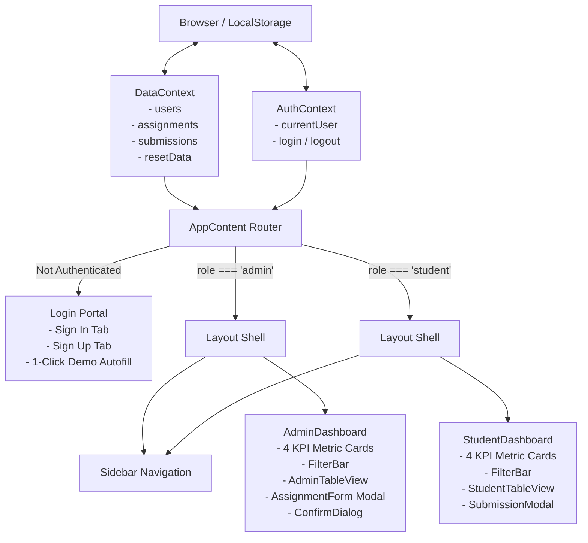
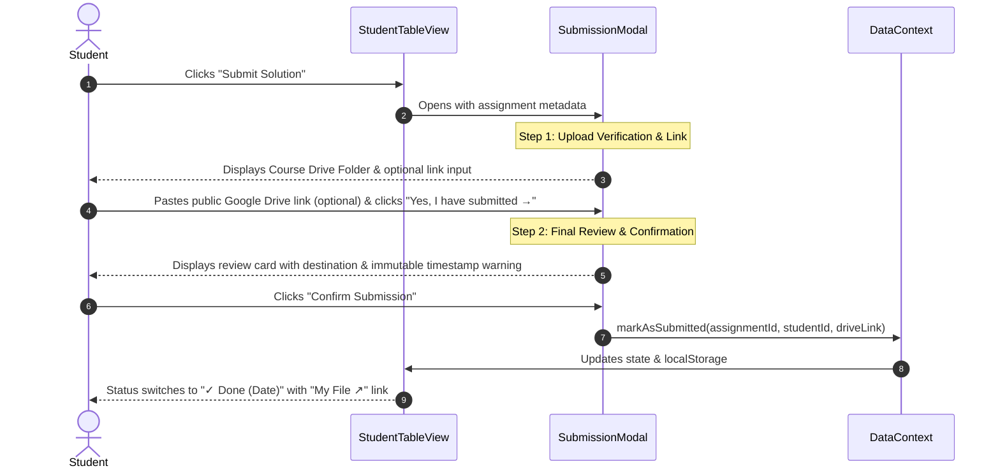

# Joineazy Academic OS — Assignment & Review Dashboard

> A high-density academic operations dashboard built with **React 19**, **Vite**, and **Tailwind CSS v4**. Designed for university faculty and students to distribute assignments, track Google Drive submissions, and monitor class completion rates in real time without external backend dependencies.

---

## Table of Contents
1. [Project Overview](#project-overview)
2. [Setup Steps](#setup-steps)
   - [Prerequisites](#prerequisites)
   - [Local Development](#local-development)
   - [Production Build & Preview](#production-build--preview)
   - [Demo Accounts & Credentials](#demo-accounts--credentials)
   - [Vercel Deployment](#vercel-deployment)
3. [Folder Structure](#folder-structure)
4. [Component Architecture](#component-architecture)
   - [Application State & Data Flow](#application-state--data-flow)
   - [Component Hierarchy](#component-hierarchy)
   - [Two-Step Submission Flow](#two-step-submission-flow)
5. [Key Design Decisions](#key-design-decisions)

---

## Project Overview

Joineazy Academic OS provides a clean, role-based workflow tailored to academic cohorts:
- **Faculty / Professors (Admin)**: Author, edit, and delete curriculum assignments; attach designated Google Drive folders; assign work to entire classes or curated student rosters; monitor live completion progress bars; and inspect individual student solution files with one click.
- **Enrolled Students**: Track assigned coursework, deadlines, and overdue warnings; upload solutions to cloud storage and submit public Drive links via a guided two-step verification modal; and monitor personal progress metrics.
- **Zero Backend Required**: Full state reactivity and persistence via React Context and browser `localStorage`, complete with corruption fallback recovery and realistic seed data.

---

## Setup Steps

### Prerequisites
- **Node.js**: Version 18.0.0 or higher
- **Package Manager**: `npm` (comes with Node.js)

### Local Development

1. **Clone the repository:**
   ```bash
   git clone <repository-url>
   cd Joineazy
   ```

2. **Install project dependencies:**
   ```bash
   npm install
   ```

3. **Start the local Vite development server:**
   ```bash
   npm run dev
   ```

4. **Access the application:**
   Open your browser and navigate to `http://localhost:5173`.

### Production Build & Preview

1. **Create an optimized production bundle:**
   ```bash
   npm run build
   ```
   *The built assets will be emitted to the `dist/` directory.*

2. **Preview the production build locally:**
   ```bash
   npm run preview
   ```

3. **Code Quality Linting:**
   ```bash
   npm run lint
   ```

### Demo Accounts & Credentials

The application is pre-seeded with 2 faculty admins and 5 students. The sign-in page includes **one-click autofill chips** for instant testing:

| Role | Full Name | Username | Password | Assigned Scope |
| :--- | :--- | :--- | :--- | :--- |
| **Faculty Admin** | Prof. Sharma | `prof.sharma` | `password123` | Author of 3 computer science modules |
| **Faculty Admin** | Prof. Iyer | `prof.iyer` | `password123` | Author of 3 engineering modules |
| **Student** | Aarav Patel | `aarav` | `password123` | Enrolled in 5 course modules |
| **Student** | Priya Nair | `priya` | `password123` | Enrolled in 5 course modules |
| **Student** | Rohan Gupta | `rohan` | `password123` | Enrolled in 4 course modules |
| **Student** | Ananya Verma | `ananya` | `password123` | Enrolled in 4 course modules |
| **Student** | Vikram Singh | `vikram` | `password123` | Enrolled in 4 course modules |

*New students and professors can also be registered at any time via the **New User Sign Up** tab.*

### Vercel Deployment

The project is configured for single-page routing on Vercel via [`vercel.json`](file:///d:/Projects/Joineazy/vercel.json):
```json
{
  "rewrites": [
    {
      "source": "/(.*)",
      "destination": "/index.html"
    }
  ]
}
```
Deploy instantly by linking your repository to [Vercel](https://vercel.com) and accepting standard Vite build settings (`npm run build`, output directory: `dist`).

---

## Folder Structure

```text
Joineazy/
├── public/
│   └── favicon.svg              # Custom Joineazy indigo squircle "J" lettermark
├── src/
│   ├── components/
│   │   ├── admin/
│   │   │   ├── AdminAssignmentCard.jsx  # Grid card variant for faculty tasks
│   │   │   ├── AdminTableView.jsx       # High-density faculty table with roster expansion
│   │   │   └── AssignmentForm.jsx       # Modal form for drafting/editing assignments
│   │   ├── common/
│   │   │   ├── ConfirmDialog.jsx        # Accessible dialog for destructive actions
│   │   │   ├── EmptyState.jsx           # Clean vector SVG empty state illustrations
│   │   │   ├── ErrorMessage.jsx         # Recovery state with 1-click storage reset
│   │   │   ├── FilterBar.jsx            # Title search, status filter, and due-date sort
│   │   │   ├── Header.jsx               # Top navigation fallback component
│   │   │   ├── Layout.jsx               # Workspace layout shell hosting the sidebar
│   │   │   ├── ProgressBar.jsx          # Reusable ARIA-accessible progress bar
│   │   │   ├── Sidebar.jsx              # SaaS workspace sidebar with view navigation
│   │   │   └── Spinner.jsx              # Accessible loading indicator
│   │   └── student/
│   │       ├── AssignmentCard.jsx       # Grid card variant for student tasks
│   │       ├── ProgressSummary.jsx      # Student completion metric overview
│   │       ├── StudentTableView.jsx     # High-density data table for student coursework
│   │       └── SubmissionModal.jsx      # Two-step Drive verification and submission modal
│   ├── context/
│   │   ├── AuthContext.jsx              # Session identity, sign-in, and sign-out logic
│   │   ├── DataContext.jsx              # Reactive CRUD state for assignments & submissions
│   │   └── ThemeContext.jsx             # Light theme consistency fallback
│   ├── data/
│   │   └── seedData.js                  # Initial realistic Indian academic faculty & student dataset
│   ├── pages/
│   │   ├── AdminDashboard.jsx           # Faculty hub: KPIs, filters, curriculum table, and modals
│   │   ├── Login.jsx                    # Centered authentication portal & demo autofill chips
│   │   └── StudentDashboard.jsx         # Student hub: KPIs, filters, and submission table
│   ├── utils/
│   │   ├── dateHelpers.js               # Formats dates (e.g., "10 Nov 2026") & checks overdue status
│   │   └── storage.js                   # Safe JSON localStorage wrapper with try/catch fallback
│   ├── App.jsx                          # Root routing shell (Loading, Error, Login, Layout)
│   ├── index.css                        # Tailwind CSS v4 entry point
│   └── main.jsx                         # React 19 DOM bootstrap
├── index.html                           # HTML entry with custom Joineazy title & favicon
├── package.json                         # Project dependencies, scripts, and engine metadata
├── vercel.json                          # Single-page application rewrites for Vercel
└── vite.config.js                       # Vite bundler configuration with @tailwindcss/vite
```

---

## Component Architecture

### Application State & Data Flow



### Component Hierarchy

1. **`App.jsx` (Root Router)**
   - Wraps the component tree in `AuthProvider` and `DataProvider`.
   - Checks `isLoading` (600ms artificial delay to prevent layout shifts).
   - Catches corrupted `localStorage` data via `hasStorageError` and renders `ErrorMessage` with a 1-click **Reset Data** action.
   - Conditionally switches between `<Login />` and `<Layout />`.

2. **`Layout.jsx` & `Sidebar.jsx`**
   - Implements a responsive SaaS layout shell.
   - Persistent left sidebar on desktop (`md:w-64`) with backdrop drawer overlay on mobile.
   - Hosts user profile pill, workspace view filters (*All Assignments*, *Pending Tasks / Incomplete Classes*, *Completed Work*), and instant sign-out.

3. **`StudentDashboard.jsx` & `StudentTableView.jsx`**
   - Displays 4 executive KPI cards: **Assigned Tasks**, **Completed**, **Pending**, and **Overdue**.
   - Integrates `FilterBar` for real-time title search, status filtering (*All / Submitted / Pending*), and due-date sorting (*Earliest first / Latest first*).
   - Renders `StudentTableView` with inline course Drive links, overdue status badges, and solution submission triggers.

4. **`AdminDashboard.jsx` & `AdminTableView.jsx`**
   - Filters assignments strictly by `createdBy === currentUser.id`.
   - Displays 4 executive KPI cards: **Active Modules**, **100% Completed**, **Incomplete Classes**, and **Total Submissions**.
   - Features `AdminTableView` with real-time class progress bars and an **expandable student roster accordion** showing individual student names, submission dates, and direct links to inspect submitted files.
   - Integrates `AssignmentForm` (modal form with field-level validation and student roster multi-select) and `ConfirmDialog` for assignment deletion.

### Two-Step Submission Flow



---

## Key Design Decisions

### 1. Zero External State/Router Libraries
- **Decision**: Built entirely using React 19 primitives (`useState`, `useEffect`, `createContext`, `useContext`) and plain JavaScript array methods (`filter`, `sort`, `some`, `map`).
- **Rationale**: Eliminates bloated dependency chains (Redux, Zustand, React Router) for an intern-level dashboard while keeping the production bundle under **85 kB (gzipped)** and compilation speeds under **300ms**.

### 2. High-Density Data Table View
- **Decision**: Shifted away from card-heavy layouts to a responsive, high-density data table format with horizontal scrolling wrappers for mobile devices.
- **Rationale**: Real-world academic administrators and students managing multiple courses require high information density. Data tables allow immediate comparison of deadlines, statuses, resources, and roster completion at a glance.

### 3. Dual-Mode Google Drive Submission Architecture
- **Decision**: Supported both the professor's designated course folder and student-provided public Google Drive links.
- **Rationale**: Addresses both institutional paradigms:
  1. *Centralized Folder*: The professor provides a shared Google Drive folder where students drop assignments.
  2. *Individual Student Links*: Students upload files to their personal Google Drive with public view permissions and share the link back.
  3. *Faculty Inspection*: When faculty view the expanded assignment roster, each submission row includes a direct **`View Work ↗`** link pointing to the student's specific Google Drive file.

### 4. Pure White / Light Modern SaaS Aesthetic
- **Decision**: Standardized on a pure white, high-contrast palette (`bg-slate-50`, `bg-white`, slate borders, indigo accents) and removed dark mode toggles and promotional side banners.
- **Rationale**: Creates an enterprise-grade aesthetic (similar to Notion, Linear, or Stripe) without visual distractions or AI-generated template cliches.

### 5. Resilient Storage & Crash Recovery
- **Decision**: Wrapped all `localStorage` access in `try/catch` handlers in [`storage.js`](file:///d:/Projects/Joineazy/src/utils/storage.js) and implemented a fallback error boundary (`hasStorageError`).
- **Rationale**: If a user's browser storage contains corrupted JSON or invalid data, the application displays a friendly recovery screen with a 1-click **"Reset data"** button that safely restores seed data without bricking the app.

---

### License & Attribution
Developed for the **Joineazy Frontend Assignment** using modern React and Tailwind CSS best practices.
